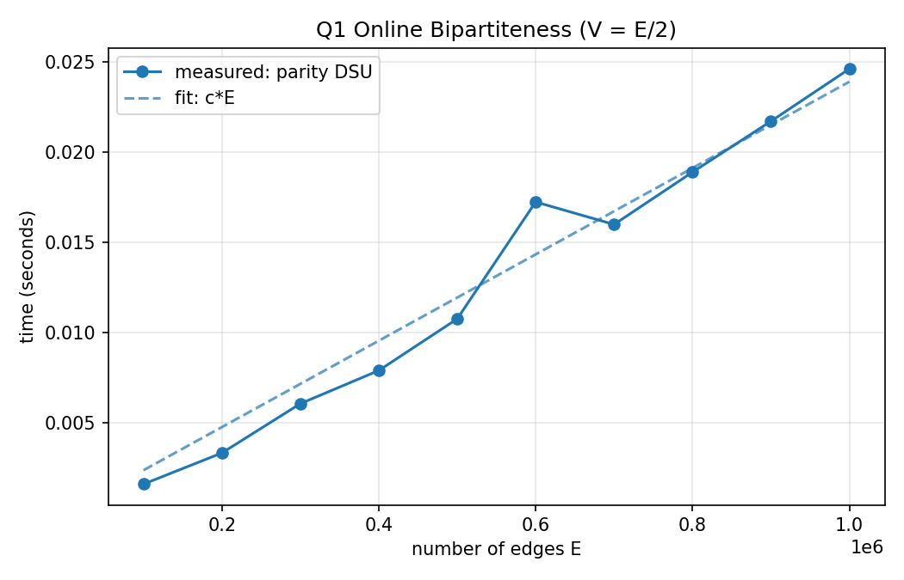
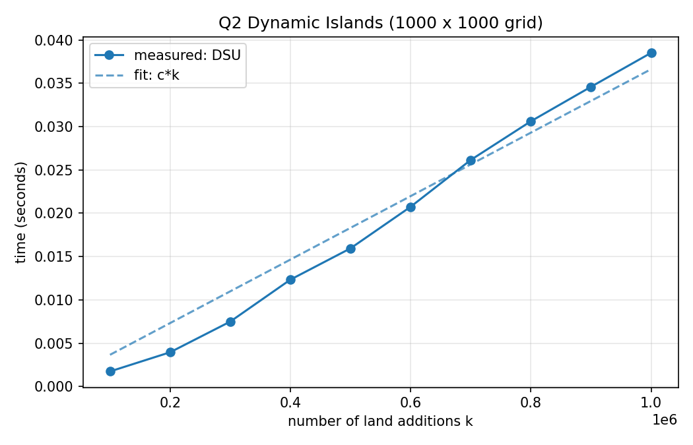
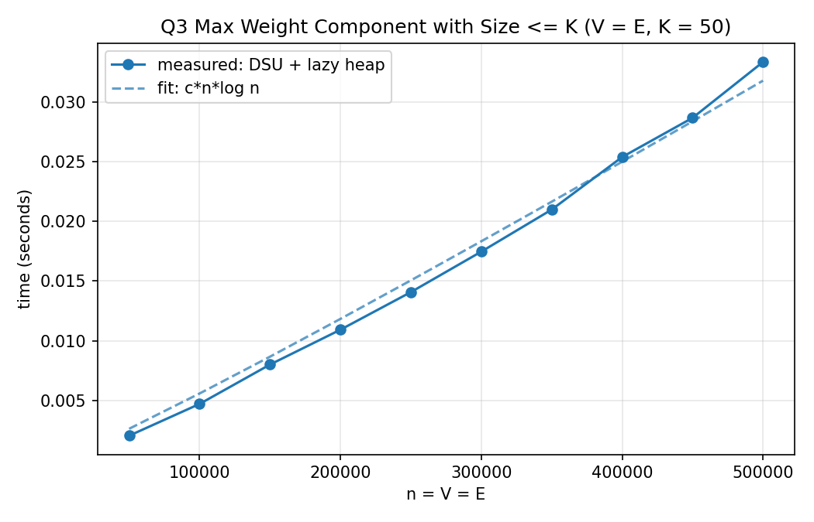
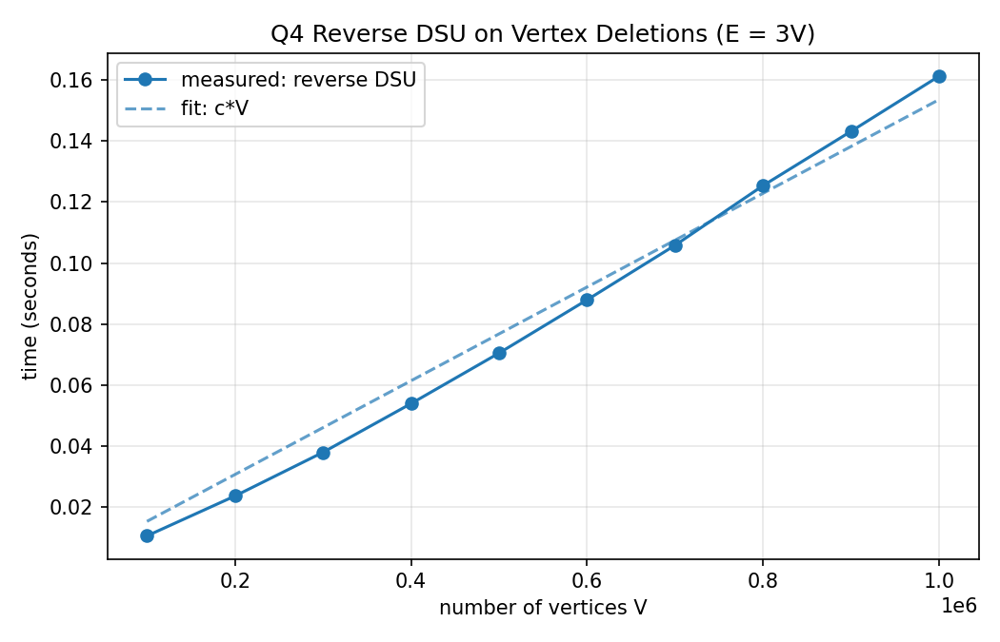

# DAA Lab 10: Graphs and Disjoint Set Union

---

## Question 1: Online Graph-Bipartiteness Testing

### Code

```c
#include <stdio.h>
#include <stdlib.h>

typedef struct {
    int *p, *par, *sz;
} DSU;

void dsu_init(DSU *d, int n)
{
    d->p = malloc((size_t)n * sizeof(int));
    d->par = calloc((size_t)n, sizeof(int));
    d->sz = malloc((size_t)n * sizeof(int));
    for (int i = 0; i < n; i++) {
        d->p[i] = i;
        d->sz[i] = 1;
    }
}

void dsu_free(DSU *d)
{
    free(d->p);
    free(d->par);
    free(d->sz);
}

int find(DSU *d, int x, int *px)
{
    int r = x, acc = 0;
    while (d->p[r] != r) {
        acc ^= d->par[r];
        r = d->p[r];
    }
    int cur = x, cp = acc;
    while (cur != r) {
        int next = d->p[cur];
        int np = cp ^ d->par[cur];
        d->p[cur] = r;
        d->par[cur] = cp;
        cur = next;
        cp = np;
    }
    *px = acc;
    return r;
}

int try_add_edge(DSU *d, int u, int v)
{
    int pu, pv;
    int ru = find(d, u, &pu), rv = find(d, v, &pv);
    if (ru == rv)
        return pu != pv;
    if (d->sz[ru] > d->sz[rv]) {
        int t = ru;
        ru = rv;
        rv = t;
    }
    d->p[ru] = rv;
    d->par[ru] = pu ^ pv ^ 1;
    d->sz[rv] += d->sz[ru];
    return 1;
}

int main(void)
{
    setvbuf(stdout, NULL, _IONBF, 0);
    int V, E;
    printf("Enter number of vertices V (vertices are 0 to V-1): ");
    if (scanf("%d", &V) != 1 || V <= 0) {
        printf("Invalid input\n");
        return 1;
    }
    printf("Enter number of edges E: ");
    if (scanf("%d", &E) != 1 || E < 0) {
        printf("Invalid input\n");
        return 1;
    }
    DSU d;
    dsu_init(&d, V);
    int added = 0, skipped = 0;
    for (int i = 0; i < E; i++) {
        int u, v;
        printf("Enter edge %d (u v): ", i + 1);
        if (scanf("%d %d", &u, &v) != 2 || u < 0 || u >= V || v < 0 || v >= V) {
            printf("Invalid input\n");
            return 1;
        }
        if (try_add_edge(&d, u, v)) {
            printf("  edge (%d, %d): added, graph is still bipartite\n", u, v);
            added++;
        } else {
            printf("  edge (%d, %d): creates an odd cycle, skipped\n", u, v);
            skipped++;
        }
    }
    printf("Edges added: %d, edges skipped: %d\n", added, skipped);
    printf("Vertex colours (0/1):");
    for (int i = 0; i < V; i++) {
        int c;
        find(&d, i, &c);
        printf(" %d", c);
    }
    printf("\n");
    dsu_free(&d);
    return 0;
}
```

### Graph



### Time Complexity

**Idea:** A DSU with parity. Every vertex stores `par[x]`, the colour difference (0 or 1) between `x` and its parent. After `find(x)` the parity to the root is the colour of `x` relative to that root.

**Adding an edge `(u, v)`:**
- If `u` and `v` are in different sets, the edge cannot close a cycle. Join the two roots and set the parity of the attached root to `parity(u) xor parity(v) xor 1`, so that `u` and `v` get different colours. The edge is added.
- If they are in the same set and `parity(u) != parity(v)`, the edge joins two differently coloured vertices, so every cycle stays even. The edge is added.
- If they are in the same set and `parity(u) == parity(v)`, the edge closes an odd cycle (a self-loop counts as an odd cycle of length 1). The edge is reported and skipped.

**Derivation:** `find` uses path compression (parities are updated along the path) and union by size, so each operation costs `O(α(V))` amortised, where `α` is the inverse Ackermann function (at most 4 for any practical input). Initialisation is `O(V)`, so `T(V, E) = O(V + E · α(V))`.

| Case | Time | Space |
|------|------|-------|
| Best / Average / Worst | `Θ(V + E · α(V))`, effectively `Θ(V + E)` | `Θ(V)` |

**Graph:** `V = E/2` in the benchmark and the measured time is linear in `E`.

---

## Question 2: Dynamic Connected Components in a Grid

### Code

```c
#include <stdio.h>
#include <stdlib.h>

typedef struct {
    int R, C, count;
    int *p, *sz;
    char *land;
} Grid;

void grid_init(Grid *g, int R, int C)
{
    g->R = R;
    g->C = C;
    g->count = 0;
    g->p = malloc((size_t)R * C * sizeof(int));
    g->sz = malloc((size_t)R * C * sizeof(int));
    g->land = calloc((size_t)R * C, 1);
    for (int i = 0; i < R * C; i++) {
        g->p[i] = i;
        g->sz[i] = 1;
    }
}

void grid_free(Grid *g)
{
    free(g->p);
    free(g->sz);
    free(g->land);
}

static int find(int *p, int x)
{
    while (p[x] != x) {
        p[x] = p[p[x]];
        x = p[x];
    }
    return x;
}

int grid_add(Grid *g, int r, int c)
{
    int id = r * g->C + c;
    if (g->land[id])
        return g->count;
    g->land[id] = 1;
    g->count++;
    static const int dr[4] = {-1, 1, 0, 0};
    static const int dc[4] = {0, 0, -1, 1};
    for (int k = 0; k < 4; k++) {
        int nr = r + dr[k], nc = c + dc[k];
        if (nr < 0 || nr >= g->R || nc < 0 || nc >= g->C)
            continue;
        int nid = nr * g->C + nc;
        if (!g->land[nid])
            continue;
        int a = find(g->p, id), b = find(g->p, nid);
        if (a == b)
            continue;
        if (g->sz[a] < g->sz[b]) {
            int t = a;
            a = b;
            b = t;
        }
        g->p[b] = a;
        g->sz[a] += g->sz[b];
        g->count--;
    }
    return g->count;
}

int main(void)
{
    setvbuf(stdout, NULL, _IONBF, 0);
    int R, C, k;
    printf("Enter number of rows R and columns C: ");
    if (scanf("%d %d", &R, &C) != 2 || R <= 0 || C <= 0) {
        printf("Invalid input\n");
        return 1;
    }
    printf("Enter number of land additions k: ");
    if (scanf("%d", &k) != 1 || k < 0) {
        printf("Invalid input\n");
        return 1;
    }
    Grid g;
    grid_init(&g, R, C);
    for (int i = 0; i < k; i++) {
        int r, c;
        printf("Enter position %d (row column, 0-indexed): ", i + 1);
        if (scanf("%d %d", &r, &c) != 2 || r < 0 || r >= R || c < 0 || c >= C) {
            printf("Invalid input\n");
            return 1;
        }
        printf("  after adding (%d, %d): %d island(s)\n", r, c, grid_add(&g, r, c));
    }
    grid_free(&g);
    return 0;
}
```

### Graph



### Time Complexity

**Idea:** Flatten the cell `(r, c)` to the index `r * C + c` and run a DSU over all `R * C` cells. Keep a counter of islands.

**Adding land at `(r, c)`:**
- If the cell is already land, the answer is unchanged.
- Otherwise mark it as land and do `count++`.
- For each of the 4 neighbours that is land, find both roots. If they differ, union them and do `count--`, because two islands merged into one.

**Derivation:** One addition does at most 4 union operations and each costs `O(α(R·C))` amortised with path compression and union by size. For `k` additions `T = O(R·C + k · α(R·C))`, where `R·C` is the initialisation. A naive method that recounts the islands with a DFS after every addition would cost `O(k · R · C)`.

| Case | Time | Space |
|------|------|-------|
| Best / Average / Worst | `Θ(R·C + k · α(R·C))` | `Θ(R·C)` |

**Graph:** The grid is 1000 x 1000 and `k` varies. The curve bends up slightly because more cells are land (more unions) and random memory access gets slower for larger `k`, but it stays close to linear.

---

## Question 3: Maximum Weight Component with Size Constraint

### Code

```c
#include <stdio.h>
#include <stdlib.h>

typedef long long ll;

typedef struct {
    ll sum;
    int root, ver;
} Node;

static void sift_up(Node *h, int i)
{
    while (i > 0) {
        int p = (i - 1) / 2;
        if (h[i].sum <= h[p].sum)
            break;
        Node t = h[i];
        h[i] = h[p];
        h[p] = t;
        i = p;
    }
}

static void sift_down(Node *h, int n, int i)
{
    for (;;) {
        int l = 2 * i + 1, r = l + 1, m = i;
        if (l < n && h[l].sum > h[m].sum)
            m = l;
        if (r < n && h[r].sum > h[m].sum)
            m = r;
        if (m == i)
            break;
        Node t = h[i];
        h[i] = h[m];
        h[m] = t;
        i = m;
    }
}

static int find(int *p, int x)
{
    while (p[x] != x) {
        p[x] = p[p[x]];
        x = p[x];
    }
    return x;
}

void max_comp_weight(int V, int K, const ll *w, int E, const int *eu, const int *ev, ll *ans)
{
    int *p = malloc((size_t)V * sizeof(int));
    int *sz = malloc((size_t)V * sizeof(int));
    int *ver = calloc((size_t)V, sizeof(int));
    ll *sum = malloc((size_t)V * sizeof(ll));
    Node *h = malloc((size_t)(V + E) * sizeof(Node));
    int hs = 0;
    for (int i = 0; i < V; i++) {
        p[i] = i;
        sz[i] = 1;
        sum[i] = w[i];
        if (K >= 1) {
            h[hs].sum = w[i];
            h[hs].root = i;
            h[hs].ver = 0;
            sift_up(h, hs++);
        }
    }
    ans[0] = hs > 0 ? h[0].sum : 0;
    for (int e = 0; e < E; e++) {
        int a = find(p, eu[e]), b = find(p, ev[e]);
        if (a != b) {
            if (sz[a] < sz[b]) {
                int t = a;
                a = b;
                b = t;
            }
            p[b] = a;
            sz[a] += sz[b];
            sum[a] += sum[b];
            ver[a]++;
            if (sz[a] <= K) {
                h[hs].sum = sum[a];
                h[hs].root = a;
                h[hs].ver = ver[a];
                sift_up(h, hs++);
            }
        }
        while (hs > 0) {
            Node t = h[0];
            if (p[t.root] == t.root && ver[t.root] == t.ver && sz[t.root] <= K)
                break;
            h[0] = h[--hs];
            sift_down(h, hs, 0);
        }
        ans[e + 1] = hs > 0 ? h[0].sum : 0;
    }
    free(p);
    free(sz);
    free(ver);
    free(sum);
    free(h);
}

int main(void)
{
    setvbuf(stdout, NULL, _IONBF, 0);
    int V, K, E;
    printf("Enter number of vertices V (vertices are 0 to V-1): ");
    if (scanf("%d", &V) != 1 || V <= 0) {
        printf("Invalid input\n");
        return 1;
    }
    printf("Enter size threshold K: ");
    if (scanf("%d", &K) != 1 || K < 0) {
        printf("Invalid input\n");
        return 1;
    }
    ll *w = malloc((size_t)V * sizeof(ll));
    printf("Enter %d vertex weights: ", V);
    for (int i = 0; i < V; i++) {
        if (scanf("%lld", &w[i]) != 1) {
            printf("Invalid input\n");
            return 1;
        }
    }
    printf("Enter number of edges E: ");
    if (scanf("%d", &E) != 1 || E < 0) {
        printf("Invalid input\n");
        return 1;
    }
    int *eu = malloc((size_t)(E + 1) * sizeof(int));
    int *ev = malloc((size_t)(E + 1) * sizeof(int));
    ll *ew = malloc((size_t)(E + 1) * sizeof(ll));
    for (int i = 0; i < E; i++) {
        printf("Enter edge %d (u v weight): ", i + 1);
        if (scanf("%d %d %lld", &eu[i], &ev[i], &ew[i]) != 3 || eu[i] < 0 || eu[i] >= V || ev[i] < 0 || ev[i] >= V) {
            printf("Invalid input\n");
            return 1;
        }
    }
    ll *ans = malloc((size_t)(E + 1) * sizeof(ll));
    max_comp_weight(V, K, w, E, eu, ev, ans);
    printf("Before any edge: %lld\n", ans[0]);
    for (int i = 0; i < E; i++)
        printf("After edge %d (%d, %d): %lld\n", i + 1, eu[i], ev[i], ans[i + 1]);
    free(w);
    free(eu);
    free(ev);
    free(ew);
    free(ans);
    return 0;
}
```

### Graph



### Time Complexity

**Idea:** A DSU keeps the size and the total vertex weight of every component. A component counts only if its size is at most `K`.

**Why a heap is needed:** The answer is not monotone. When two small components merge into one whose size exceeds `K`, both disappear from the valid set, so the maximum can go down. So all valid components are kept in a max-heap with **lazy deletion**. Every entry stores `(sum, root, version)`. A merge increments the version of the new root and pushes a fresh entry if its size is at most `K`. Before answering, stale entries are popped from the top: an entry is stale if its root is no longer a root, its version changed, or its size is above `K`.

**Edge weights:** The edge weights do not change which vertices are connected, so they are read but not used for the component weights.

**Derivation:** The heap receives at most `V + E` entries (one per vertex and one per successful merge) and each entry is pushed and popped at most once, each at `O(log(V + E))`. The DSU part is `O((V + E) · α(V))`. So `T = O((V + E) log(V + E))`.

| Case | Time | Space |
|------|------|-------|
| Best / Average / Worst | `Θ((V + E) log(V + E))` | `Θ(V + E)` |

**Graph:** `V = E = n` and `K = 50` in the benchmark, and the measured time follows `n log n`.

---

## Question 4: Reverse Time-Step DSU Application

### Code

```c
#include <stdio.h>
#include <stdlib.h>

typedef long long ll;

static int find(int *p, int x)
{
    while (p[x] != x) {
        p[x] = p[p[x]];
        x = p[x];
    }
    return x;
}

void max_after_deletions(int V, const ll *w, int E, const int *eu, const int *ev, const int *P, ll *ans)
{
    int *start = calloc((size_t)V + 1, sizeof(int));
    for (int i = 0; i < E; i++) {
        start[eu[i] + 1]++;
        start[ev[i] + 1]++;
    }
    for (int i = 0; i < V; i++)
        start[i + 1] += start[i];
    int *fill = malloc((size_t)V * sizeof(int));
    for (int i = 0; i < V; i++)
        fill[i] = start[i];
    int *adj = malloc((size_t)(2 * E + 1) * sizeof(int));
    for (int i = 0; i < E; i++) {
        adj[fill[eu[i]]++] = ev[i];
        adj[fill[ev[i]]++] = eu[i];
    }
    int *p = malloc((size_t)V * sizeof(int));
    int *sz = malloc((size_t)V * sizeof(int));
    ll *sum = malloc((size_t)V * sizeof(ll));
    char *active = calloc((size_t)V, 1);
    ll best = 0;
    ans[V] = 0;
    for (int j = V - 1; j >= 0; j--) {
        int v = P[j];
        active[v] = 1;
        p[v] = v;
        sz[v] = 1;
        sum[v] = w[v];
        for (int k = start[v]; k < start[v + 1]; k++) {
            int u = adj[k];
            if (!active[u])
                continue;
            int a = find(p, v), b = find(p, u);
            if (a == b)
                continue;
            if (sz[a] < sz[b]) {
                int t = a;
                a = b;
                b = t;
            }
            p[b] = a;
            sz[a] += sz[b];
            sum[a] += sum[b];
        }
        ll cur = sum[find(p, v)];
        if (cur > best)
            best = cur;
        ans[j] = best;
    }
    free(start);
    free(fill);
    free(adj);
    free(p);
    free(sz);
    free(sum);
    free(active);
}

int main(void)
{
    setvbuf(stdout, NULL, _IONBF, 0);
    int V, E;
    printf("Enter number of vertices V (vertices are 0 to V-1): ");
    if (scanf("%d", &V) != 1 || V <= 0) {
        printf("Invalid input\n");
        return 1;
    }
    ll *w = malloc((size_t)V * sizeof(ll));
    printf("Enter %d non-negative vertex values: ", V);
    for (int i = 0; i < V; i++) {
        if (scanf("%lld", &w[i]) != 1 || w[i] < 0) {
            printf("Invalid input\n");
            return 1;
        }
    }
    printf("Enter number of edges E: ");
    if (scanf("%d", &E) != 1 || E < 0) {
        printf("Invalid input\n");
        return 1;
    }
    int *eu = malloc((size_t)(E + 1) * sizeof(int));
    int *ev = malloc((size_t)(E + 1) * sizeof(int));
    for (int i = 0; i < E; i++) {
        printf("Enter edge %d (u v): ", i + 1);
        if (scanf("%d %d", &eu[i], &ev[i]) != 2 || eu[i] < 0 || eu[i] >= V || ev[i] < 0 || ev[i] >= V) {
            printf("Invalid input\n");
            return 1;
        }
    }
    int *P = malloc((size_t)V * sizeof(int));
    char *seen = calloc((size_t)V, 1);
    printf("Enter the deletion order (%d distinct vertices): ", V);
    for (int i = 0; i < V; i++) {
        if (scanf("%d", &P[i]) != 1 || P[i] < 0 || P[i] >= V || seen[P[i]]) {
            printf("Invalid input\n");
            return 1;
        }
        seen[P[i]] = 1;
    }
    ll *ans = malloc((size_t)(V + 1) * sizeof(ll));
    max_after_deletions(V, w, E, eu, ev, P, ans);
    printf("Before any deletion: %lld\n", ans[0]);
    for (int i = 0; i < V; i++)
        printf("After deleting vertex %d: %lld\n", P[i], ans[i + 1]);
    free(w);
    free(eu);
    free(ev);
    free(P);
    free(seen);
    free(ans);
    return 0;
}
```

### Graph



### Time Complexity

**Idea:** A DSU supports merging but not deletion, so process the deletions **in reverse**. Start with an empty graph and add the vertices in the order `p_V, p_(V-1), ..., p_1`. After the vertex set `{p_(i+1), ..., p_V}` has been added, the current maximum component sum is exactly the answer after deleting `p_1..p_i`.

**Adding vertex `v`:** Activate it with sum `w[v]`, then union it with every active neighbour using a compressed adjacency list (CSR). Update `best = max(best, sum of the component of v)`. The answers are stored by index, so `ans[0]` is the full graph (before any deletion) and `ans[V]` is 0.

**Assumption:** Vertex values are non-negative. Merging then never lowers a component sum, so a running maximum is enough.

**Derivation:** Building the adjacency list is `O(V + E)`. Every vertex is activated once and every edge is looked at twice (once from each end), each union or find costing `O(α(V))`. So `T = O(V + E · α(V))`. A naive method that recomputes the components after every deletion costs `O(V · (V + E))`.

| Case | Time | Space |
|------|------|-------|
| Best / Average / Worst | `Θ(V + E · α(V))` | `Θ(V + E)` |

**Graph:** `E = 3V` in the benchmark and the measured time is close to linear in `V`.

---

## Question 5: Lexicographically Smallest Permutation via Swaps

### Code

```c
#include <stdio.h>
#include <stdlib.h>

static int find(int *p, int x)
{
    while (p[x] != x) {
        p[x] = p[p[x]];
        x = p[x];
    }
    return x;
}

static int cmp_int(const void *a, const void *b)
{
    int x = *(const int *)a, y = *(const int *)b;
    return (x > y) - (x < y);
}

void smallest_permutation(int n, int *a, int m, const int *eu, const int *ev)
{
    int *p = malloc((size_t)n * sizeof(int));
    int *sz = malloc((size_t)n * sizeof(int));
    for (int i = 0; i < n; i++) {
        p[i] = i;
        sz[i] = 1;
    }
    for (int i = 0; i < m; i++) {
        int x = find(p, eu[i]), y = find(p, ev[i]);
        if (x == y)
            continue;
        if (sz[x] < sz[y]) {
            int t = x;
            x = y;
            y = t;
        }
        p[y] = x;
        sz[x] += sz[y];
    }
    int *start = calloc((size_t)n + 1, sizeof(int));
    int *root = malloc((size_t)n * sizeof(int));
    for (int i = 0; i < n; i++) {
        root[i] = find(p, i);
        start[root[i] + 1]++;
    }
    for (int i = 0; i < n; i++)
        start[i + 1] += start[i];
    int *fill = malloc((size_t)n * sizeof(int));
    for (int i = 0; i < n; i++)
        fill[i] = start[i];
    int *pos = malloc((size_t)n * sizeof(int));
    int *val = malloc((size_t)n * sizeof(int));
    for (int i = 0; i < n; i++) {
        int k = fill[root[i]]++;
        pos[k] = i;
        val[k] = a[i];
    }
    for (int r = 0; r < n; r++)
        if (start[r + 1] - start[r] > 1)
            qsort(val + start[r], (size_t)(start[r + 1] - start[r]), sizeof(int), cmp_int);
    for (int k = 0; k < n; k++)
        a[pos[k]] = val[k];
    free(p);
    free(sz);
    free(start);
    free(root);
    free(fill);
    free(pos);
    free(val);
}

int main(void)
{
    setvbuf(stdout, NULL, _IONBF, 0);
    int n, m;
    printf("Enter n (permutation of 1..n): ");
    if (scanf("%d", &n) != 1 || n <= 0) {
        printf("Invalid input\n");
        return 1;
    }
    int *a = malloc((size_t)n * sizeof(int));
    char *seen = calloc((size_t)n + 1, 1);
    printf("Enter the permutation of %d numbers: ", n);
    for (int i = 0; i < n; i++) {
        if (scanf("%d", &a[i]) != 1 || a[i] < 1 || a[i] > n || seen[a[i]]) {
            printf("Invalid input\n");
            return 1;
        }
        seen[a[i]] = 1;
    }
    printf("Enter number of allowed swaps m: ");
    if (scanf("%d", &m) != 1 || m < 0) {
        printf("Invalid input\n");
        return 1;
    }
    int *eu = malloc((size_t)(m + 1) * sizeof(int));
    int *ev = malloc((size_t)(m + 1) * sizeof(int));
    for (int i = 0; i < m; i++) {
        printf("Enter swap %d (positions u v, 1-indexed): ", i + 1);
        if (scanf("%d %d", &eu[i], &ev[i]) != 2 || eu[i] < 1 || eu[i] > n || ev[i] < 1 || ev[i] > n) {
            printf("Invalid input\n");
            return 1;
        }
        eu[i]--;
        ev[i]--;
    }
    smallest_permutation(n, a, m, eu, ev);
    printf("Lexicographically smallest permutation:");
    for (int i = 0; i < n; i++)
        printf(" %d", a[i]);
    printf("\n");
    free(a);
    free(seen);
    free(eu);
    free(ev);
    return 0;
}
```

### Graph


### Time Complexity

**Idea:** If positions are connected through allowed swaps (directly or through a chain), their values can be rearranged in any order. So each connected component can be sorted independently, and the lexicographically smallest result puts the **smallest values at the smallest positions** of every component.

**Steps:**
1. Union the two positions of every allowed swap in a DSU.
2. Group positions by component. Scanning positions from left to right already gives each group's positions in increasing order.
3. Collect the values of every group, sort them, and write them back to the group's positions in increasing order.

**Derivation:** Step 1 costs `O(m · α(n))`. Grouping with a counting pass costs `O(n)`. Sorting the groups costs `sum of k_i log k_i <= n log n`, where `k_i` are the component sizes. So `T = O(m · α(n) + n log n)`.

| Case | Time | Space |
|------|------|-------|
| Best / Average / Worst | `Θ(m · α(n) + n log n)` | `Θ(n)` |

**Validation:** The result was compared with a brute-force search over all reachable permutations on 5000 random small cases, with no mismatches.

**Graph:** `m = n/2` in the benchmark, and the measured time follows `n log n`.
